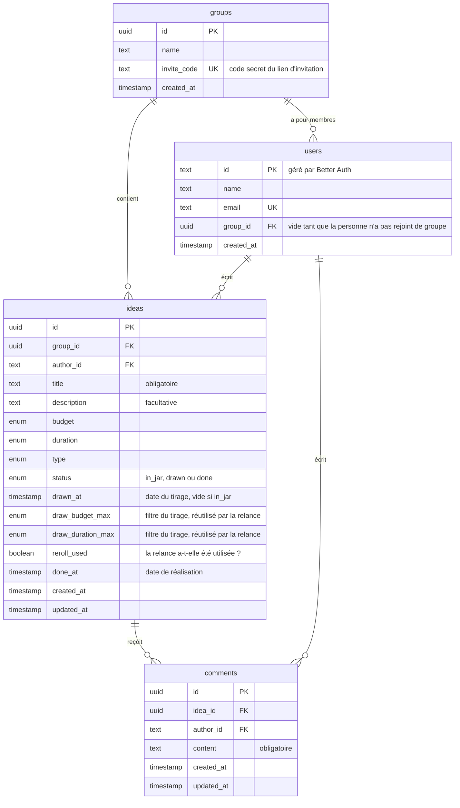

# Bocal — Modèle de données

Le schéma de la base de données du MVP, déduit de [MVP.md](MVP.md).
Les noms de tables et de colonnes sont en anglais, comme dans le code.

## Schéma

**Légende :** `PK` = identifiant unique de la ligne · `FK` = clé étrangère (lien vers un autre tableau) · `UK` = valeur unique dans tout le tableau.
`||--o{` se lit « un… plusieurs ».

## Les listes de valeurs (enums)

| Enum | Valeurs dans le code | Affichage |
|---|---|---|
| `budget` | `free`, `low`, `medium`, `high` | Gratuit · € · €€ · €€€ |
| `duration` | `under_2h`, `evening`, `half_day`, `full_day`, `weekend` | Moins de 2h · Une soirée · Une demi-journée · Une journée · Un week-end |
| `type` | `food`, `exhibition`, `crafts`, `shopping`, `sport`, `games`, `travel`, `show`, `other` | Nourriture · Expo · Activité manuelle · Shopping · Sport · Jeux · Voyage · Spectacle · Autre |
| `status` | `in_jar`, `drawn`, `done` | Non tirée · Tirée · Effectuée |

L'ordre des valeurs de `budget` et de `duration` compte : il permet le filtre « au maximum… ».

## Comment les règles du MVP se traduisent

| Règle | Où elle vit |
|---|---|
| **Une seule idée tirée par groupe** | Une **contrainte dans la base** : un index unique sur `group_id`, limité aux lignes où `status = 'drawn'`. Même si deux tirages arrivent à la même seconde, la base refuse le second |
| **Date limite de 7 jours** | **Pas stockée** : elle se calcule (`drawn_at` + 7 jours). C'est de l'état dérivé |
| **Expiration en attente de réponse** | **Pas stockée** : `status = 'drawn'` et date limite dépassée |
| **Bocal mystère** | **Pas de colonne** : c'est l'API qui n'envoie que `type`, `budget` et `duration` pour les idées `in_jar` des autres membres |
| **Seul l'auteur modifie ou supprime son idée** | L'API compare `author_id` avec l'utilisateur connecté |
| **Relance avec les mêmes filtres** | `draw_budget_max` et `draw_duration_max` mémorisent les filtres du tirage |
| **Une seule relance par tirage** | `reroll_used` passe à `true` sur l'idée tirée par la relance |
| **L'idée refusée est exclue de la relance** | **Pas de colonne** : au moment de la relance, l'API connaît l'idée refusée et l'exclut de la recherche |
| **Retour dans le bocal** (relance ou réponse « non ») | `status` repasse à `in_jar`, et `drawn_at`, les filtres et `reroll_used` sont remis à zéro |

## Notes

- **Les tables d'authentification** (`session`, `account`, `verification`) sont créées par Better Auth et n'apparaissent pas ici. On ajoute seulement la colonne `group_id` à sa table `users`.
- **Les identifiants sont des UUID** (par exemple `3f2a9c1e-…`) plutôt que des numéros qui se suivent (1, 2, 3…). Impossible de deviner l'identifiant d'une autre idée ou d'un autre groupe en ajoutant 1.
- **Pour plus tard :** le passage à plusieurs groupes par membre remplacera `users.group_id` par une table intermédiaire `memberships`. Un historique des tirages ajouterait une table `draws`.
