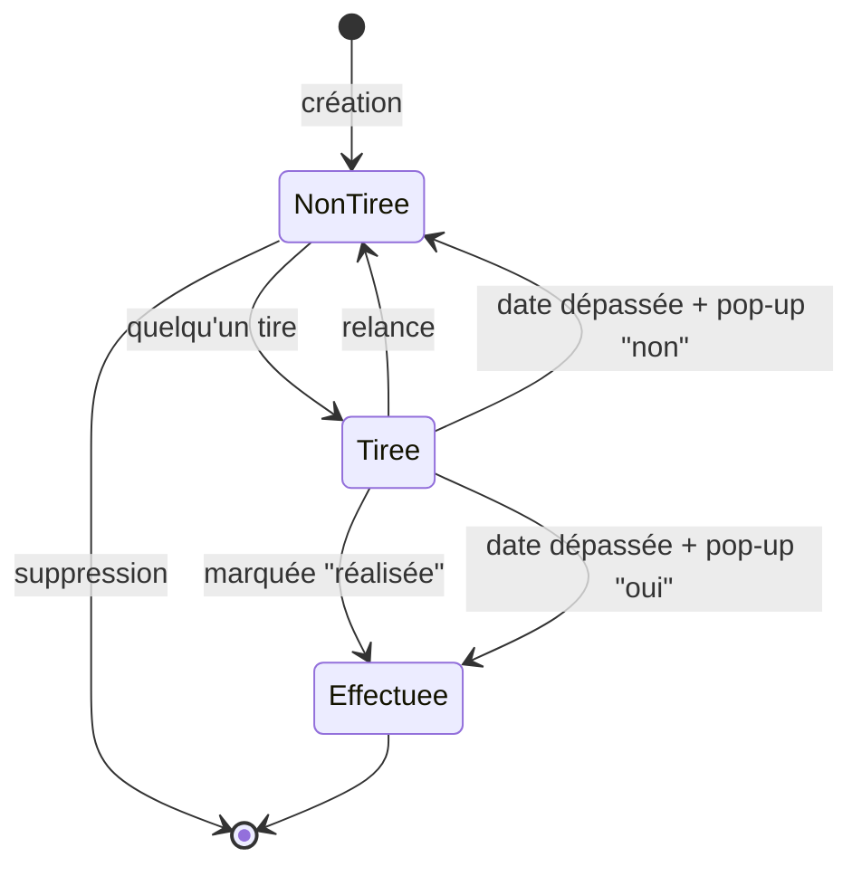

# Bocal — MVP

## Concept

Bocal est une application web collaborative qui permet à un groupe d'amis de remplir un « bocal » commun d'idées d'activités, d'en tirer une au hasard, de la réaliser, puis d'en garder un souvenir.

**Boucle principale :**

> Créer un groupe → Inviter des amis → Remplir le bocal → Tirer une activité → La réaliser → Garder un souvenir

---

## Périmètre du MVP

### Comptes

- Inscription et connexion.

### Groupe

- Un utilisateur appartient à **un seul groupe**.
- On rejoint un groupe via un **lien d'invitation**.
- Une idée appartient toujours à un groupe (pour passer plus tard à plusieurs groupes sans tout casser).

### Idées

- N'importe quel membre peut créer une idée.
- **Seul l'auteur** d'une idée peut la modifier ou la supprimer. Il voit ses propres idées en entier (vue « Mes idées »).
- Une idée ne peut être **modifiée ou supprimée que lorsqu'elle est dans le bocal** (statut `non tirée`).
- Une idée a un **titre** (obligatoire) et une **description** (facultative), qui peut par exemple contenir le lien du lieu ou du menu.
- **Le bocal est mystère** : pour les idées `non tirée` des autres, les membres ne voient que l'**emoji du type**, le **budget** et la **durée**. Le titre et la description ne sont révélés qu'au tirage.
  - Ce masquage est garanti **par le serveur** : le titre et la description des idées `non tirée` ne sont jamais envoyés au navigateur.
- Chaque idée a trois critères, choisis dans des listes prédéfinies :

| Critère | Valeurs | Usage |
|---|---|---|
| Budget | Gratuit · € · €€ · €€€ | Filtre du tirage (liste ordonnée) |
| Durée | Moins de 2h · Une soirée *(2 à 4h)* · Une demi-journée *(4 à 6h)* · Une journée · Un week-end | Filtre du tirage (liste ordonnée) |
| Type | Nourriture · Expo · Activité manuelle · Shopping · Sport · Jeux · Voyage · Spectacle · Autre | **Affichage seulement** (avec un emoji), pas de filtre |

### Tirage

- N'importe quel membre peut lancer un tirage.
- Le tirage est aléatoire parmi les idées `non tirée`, avec des filtres facultatifs sur le **budget** et la **durée**.
- **Une seule idée `tirée` à la fois par groupe.** Cette règle est garantie **par le serveur**, notamment si deux membres tirent au même moment.
- L'idée tirée devient « l'activité de la semaine », visible par tout le groupe.

### Relance

- **Une seule relance par tirage**, utilisable par n'importe quel membre, tant que l'activité n'est **ni expirée ni réalisée**.
- La nouvelle idée démarre un **nouveau compte à rebours de 7 jours**.
- L'idée refusée retourne dans le bocal (`non tirée`).
- La relance **exclut l'idée qui vient d'être refusée**.
- La relance utilise **les mêmes filtres** que le tirage initial. Si aucune idée ne correspond, une pop-up propose de **modifier les filtres**. Si le bocal ne contient aucune autre idée, un message indique que la relance est impossible.

### Compte à rebours et expiration

- Chaque tirage démarre un compte à rebours de **durée fixe : 7 jours**.
- L'expiration est un **état calculé** : `tirée` + date limite dépassée. Aucune tâche planifiée côté serveur.
- Après l'échéance, une pop-up « L'activité a-t-elle été réalisée ? » s'affiche pour **le premier membre qui ouvre l'app**. Sa réponse vaut pour tout le groupe :
  - **Oui** : l'idée passe à `effectuée`.
  - **Non** : l'idée retourne dans le bocal (`non tirée`).
- On peut fermer la pop-up sans répondre, mais **aucun nouveau tirage n'est possible** tant qu'elle n'a pas de réponse.

### Réalisation et souvenirs

- N'importe quel membre peut marquer l'activité comme **réalisée**, à tout moment.
- Les membres peuvent ajouter des **commentaires texte** sur une activité réalisée.
- Chaque membre peut **modifier ou supprimer ses propres commentaires**, et uniquement les siens.

---

## Cycle de vie d'une idée

- **États stockés :** `non tirée`, `tirée`, `effectuée` (état final).
- **État dérivé :** « expirée, en attente de réponse » = `tirée` + date limite dépassée. Cet état n'est pas stocké, il est calculé.

---

## Hors MVP (plus tard)

- Photos et souvenirs illustrés
- Stickers à débloquer
- Vote pour relancer un tirage
- Durée du compte à rebours configurable
- Plusieurs groupes par utilisateur
- Plusieurs types par idée, filtre par type
- Notifications (email, push)
- Identité visuelle scrapbooking aboutie
- Suppression de compte (RGPD), avec la question de ce que deviennent les idées et les commentaires de la personne

---

## Backlog

Les fonctionnalités sont rangées dans l'ordre de la boucle principale, qui est aussi l'ordre de développement conseillé.

### Comptes

- [ ] S'inscrire
- [ ] Se connecter
- [ ] Se déconnecter

### Groupe

- [ ] Créer un groupe (avec un nom)
- [ ] Obtenir et partager le lien d'invitation du groupe
- [ ] Rejoindre un groupe via le lien d'invitation (refusé si je suis déjà dans un groupe)
- [ ] Voir les membres du groupe

### Idées

- [ ] Ajouter une idée (titre, description facultative, budget, durée, type)
- [ ] Voir le bocal mystère (emoji, budget et durée de chaque idée, sans titre ni description)
- [ ] Voir mes idées en entier (vue « Mes idées »)
- [ ] Modifier une de mes idées, uniquement si elle est `non tirée`
- [ ] Supprimer une de mes idées, uniquement si elle est `non tirée`

### Tirage

- [ ] Choisir des filtres facultatifs (budget max, durée max)
- [ ] Tirer une idée au hasard parmi les idées `non tirée` qui correspondent aux filtres
- [ ] Être informé si aucune idée ne correspond (bocal vide ou filtres trop restrictifs)
- [ ] Voir l'activité de la semaine et son compte à rebours
- [ ] Relancer une fois (l'idée refusée est exclue de la relance)
- [ ] Modifier les filtres de la relance si aucune idée ne correspond

### Réalisation

- [ ] Marquer l'activité de la semaine comme réalisée
- [ ] Répondre à la pop-up d'expiration (« oui » → `effectuée`, « non » → `non tirée`)
- [ ] Fermer la pop-up sans répondre (le tirage reste bloqué)

### Souvenirs

- [ ] Voir la liste des activités réalisées
- [ ] Ajouter un commentaire sur une activité réalisée
- [ ] Voir les commentaires d'une activité réalisée
- [ ] Modifier ou supprimer un de mes commentaires

---

## Critères d'acceptation

Chaque critère doit pouvoir être vérifié sans ambiguïté. Ils serviront de base aux tests.
Les critères marqués sont des propositions qui attendent une décision.

### Idées et bocal mystère

- Si on essaie de créer une idée sans titre, alors l'idée n'est pas créée et un message l'indique.
- Si une idée est `non tirée`, alors les membres autres que l'auteur ne voient que son emoji, son budget et sa durée.
- Si une idée est `non tirée`, alors le serveur n'envoie jamais son titre ni sa description au navigateur d'un membre autre que l'auteur.
- Si je suis l'auteur d'une idée, alors je vois son titre et sa description dans « Mes idées ».
- Si un membre essaie de modifier ou de supprimer une idée dont il n'est pas l'auteur, alors le serveur refuse.
- Si une idée est `tirée` ou `effectuée`, alors elle ne peut plus être supprimée.
- Si une idée est `tirée` ou `effectuée`, alors elle ne peut plus être modifiée.

### Tirage

- Si une idée est déjà `tirée` dans le groupe (expirée ou non), alors le tirage est refusé.
- Si aucun filtre n'est choisi, alors le tirage se fait parmi toutes les idées `non tirée` du groupe.
- Si des filtres sont choisis, alors seules les idées dont le budget **et** la durée sont inférieurs ou égaux aux maximums choisis peuvent être tirées.
- Si aucune idée `non tirée` ne correspond, alors aucun tirage n'a lieu et un message l'indique.
- Si le tirage réussit, alors l'idée passe à `tirée`, son titre et sa description sont révélés à tous les membres, et un compte à rebours de 7 jours démarre.
- Si deux membres lancent un tirage au même moment, alors une seule idée est tirée et les deux voient la même activité de la semaine.
- Une idée d'un autre groupe ne peut jamais être tirée.

### Relance

- Si une idée est `tirée` et que la relance n'a pas encore été utilisée, alors n'importe quel membre peut relancer.
- Si la relance a déjà été utilisée pour ce tirage, alors toute nouvelle relance est refusée.
- Si on relance, alors l'idée refusée repasse à `non tirée` et une autre idée est tirée **avec les mêmes filtres** que le tirage initial.
- Si on relance, alors l'idée refusée ne peut pas être tirée lors de cette relance. Elle reste dans le bocal pour les tirages suivants.
- Si on relance, alors un nouveau compte à rebours de 7 jours démarre pour la nouvelle idée.
- Si aucune autre idée ne correspond aux filtres, alors une pop-up propose de modifier les filtres, et l'idée initiale reste `tirée` en attendant.
- Si le membre modifie les filtres et qu'une idée correspond, alors cette idée est tirée et la relance est consommée.
- Si le membre ferme la pop-up sans relancer, alors l'idée initiale reste `tirée` et la relance n'est pas consommée.
- Si le bocal ne contient aucune autre idée `non tirée`, quels que soient les filtres, alors la relance est impossible et un message l'indique.
- Si l'activité est expirée ou déjà `effectuée`, alors la relance n'est plus possible.

### Expiration

- Si une idée est `tirée` depuis plus de 7 jours, alors la pop-up « L'activité a-t-elle été réalisée ? » s'affiche au prochain membre qui ouvre l'app.
- Si un membre répond « oui », alors l'idée passe à `effectuée` et apparaît dans la liste des activités réalisées.
- Si un membre répond « non », alors l'idée repasse à `non tirée` (elle redevient mystère) et un nouveau tirage devient possible.
- Si un membre ferme la pop-up sans répondre, alors elle s'affiche de nouveau à la prochaine ouverture de l'app, et le tirage reste refusé.
- Si un membre a déjà répondu, alors la pop-up ne s'affiche plus pour personne.
- Si deux membres répondent au même moment, alors seule la première réponse est prise en compte.
- Si l'activité a été marquée réalisée avant la fin des 7 jours, alors aucune pop-up ne s'affiche.

### Commentaires

- Si une idée n'est pas `effectuée`, alors il est impossible de la commenter.
- Si un membre essaie de modifier ou de supprimer un commentaire dont il n'est pas l'auteur, alors le serveur refuse.
