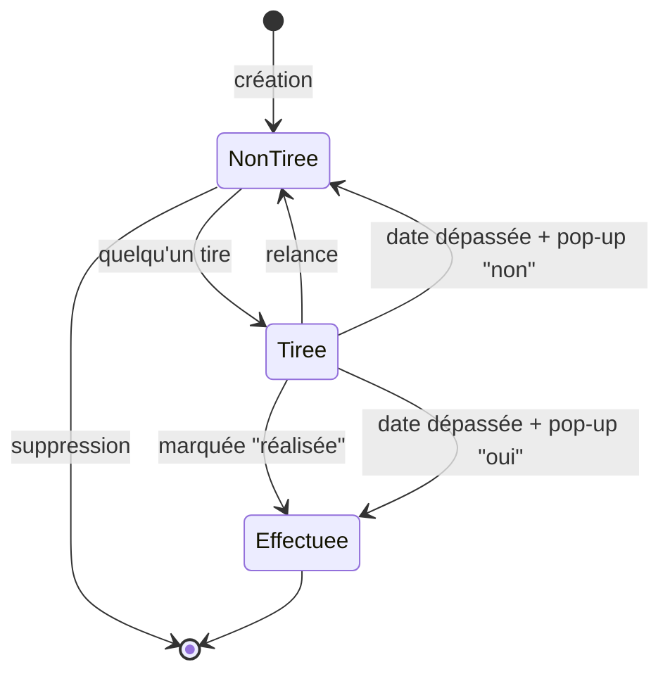

# Bocal — MVP

## Concept

Bocal est une application web collaborative qui permet à un groupe d'amis de remplir un « bocal » commun d'idées d'activités, d'en tirer une au hasard, de la réaliser, puis d'en garder un souvenir.

**Boucle principale :**

> Créer un groupe → Inviter des amis → Remplir le bocal → Tirer une activité → La réaliser → Garder un souvenir

---

## Périmètre du MVP

### Comptes

- Inscription et connexion.

### Groupe

- Un utilisateur appartient à **un seul groupe**.
- On rejoint un groupe via un **lien d'invitation**.
- Une idée appartient toujours à un groupe (pour passer plus tard à plusieurs groupes sans tout casser).

### Idées

- N'importe quel membre peut créer ou modifier une idée.
- Une idée ne peut être **supprimée que lorsqu'elle est dans le bocal** (statut `non tirée`).
- Chaque idée a trois critères, choisis dans des listes prédéfinies :

| Critère | Valeurs | Usage |
|---|---|---|
| Budget | Gratuit · € · €€ · €€€ | Filtre du tirage (liste ordonnée) |
| Durée | Moins de 2h · Une soirée *(2 à 4h)* · Une demi-journée *(4 à 6h)* · Une journée · Un week-end | Filtre du tirage (liste ordonnée) |
| Type | Nourriture · Expo · Activité manuelle · Shopping · Sport · Jeux · Voyage · Spectacle · Autre | **Affichage seulement** (avec un emoji), pas de filtre |

### Tirage

- N'importe quel membre peut lancer un tirage.
- Le tirage est aléatoire parmi les idées `non tirée`, avec des filtres facultatifs sur le **budget** et la **durée**.
- **Une seule idée `tirée` à la fois par groupe.** Cette règle est garantie **par le serveur**, notamment si deux membres tirent au même moment.
- L'idée tirée devient « l'activité de la semaine », visible par tout le groupe.

### Relance

- **Une seule relance par tirage**, utilisable par n'importe quel membre.
- L'idée refusée retourne dans le bocal (`non tirée`).
- La relance **exclut l'idée qui vient d'être refusée**.

### Compte à rebours et expiration

- Chaque tirage démarre un compte à rebours de **durée fixe**.
- L'expiration est un **état calculé** : `tirée` + date limite dépassée. Aucune tâche planifiée côté serveur.
- Après l'échéance, une pop-up « L'activité a-t-elle été réalisée ? » s'affiche pour **le premier membre qui ouvre l'app**. Sa réponse vaut pour tout le groupe :
  - **Oui** : l'idée passe à `effectuée`.
  - **Non** : l'idée retourne dans le bocal (`non tirée`).
- On peut fermer la pop-up sans répondre, mais **aucun nouveau tirage n'est possible** tant qu'elle n'a pas de réponse.

### Réalisation et souvenirs

- N'importe quel membre peut marquer l'activité comme **réalisée**, à tout moment.
- Les membres peuvent ajouter des **commentaires texte** sur une activité réalisée.

---

## Cycle de vie d'une idée

- **États stockés :** `non tirée`, `tirée`, `effectuée` (état final).
- **État dérivé :** « expirée, en attente de réponse » = `tirée` + date limite dépassée. Cet état n'est pas stocké, il est calculé.

---

## Hors MVP (plus tard)

- Photos et souvenirs illustrés
- Stickers à débloquer
- Vote pour relancer un tirage
- Durée du compte à rebours configurable
- Plusieurs groupes par utilisateur
- Plusieurs types par idée, filtre par type
- Notifications (email, push)
- Identité visuelle scrapbooking aboutie

---

## Backlog

> ✏️ À compléter : la liste des fonctionnalités à construire, en cases à cocher.

- [ ] Se déconnecter

---

## Critères d'acceptation

> ✏️ À compléter : 3 à 5 règles « si… alors… » par fonctionnalité.

### Tirage

- Si une idée est déjà `tirée` dans le groupe, alors le tirage est refusé.

### Relance

### Expiration
